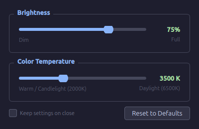

# Candela

> Manual brightness and color temperature control for Linux — named after the SI unit of luminous intensity.

A clean, dark-themed desktop utility for tuning your monitor at night (or any time). Two sliders: one for brightness, one for color temperature in Kelvin. No automatic scheduling — just instant manual control when you want it.



## Why Candela?

Most Linux tools in this space are either time-based and automatic (Redshift, Gammastep), command-line only (`xrandr`, `sct`), or have dated UIs that expose raw R/G/B gamma channels instead of a human-friendly Kelvin temperature slider. Candela aims to be the tool you reach for when you just want to quickly dim your screen and warm the color for late-night use.

## Features

- **Brightness slider** — 20% to 100% (software gamma below ~20% is effectively a black screen)
- **Color temperature slider** — 2000K (warm candlelight) to 6500K (daylight)
- **Multi-monitor support** — dropdown auto-populated from connected outputs
- **Instant apply** — changes take effect as you move the slider
- **Settings persist** after closing, within your X session (until logout/reboot)
- **Reset to Defaults** button restores 6500K / 100% brightness
- Dark UI — easy on the eyes when you need it most

## Requirements

**Python:** 3.10+

**Python packages:**
```bash
pip install PyQt6
```

**System packages:**
```bash
sudo apt install redshift        # Debian / Ubuntu / Mint
sudo dnf install redshift        # Fedora
sudo pacman -S redshift          # Arch / Manjaro
```
`redshift` handles color temperature. Brightness works without it (software gamma via `xrandr`).

When redshift is available, Candela keeps a long-lived `redshift` process running in the background (instead of a one-shot call) so your brightness/temp setting survives DPMS sleep, screen lock, and other events that reset the display's gamma ramp. That process is replaced whenever you change a slider and is stopped when Candela quits.

> **Note:** X11 only. Wayland is not currently supported.

> **Other gamma tools:** Anything else that adjusts brightness/color temperature —
> KDE Plasma's **Night Color**, `redshift-gtk`, `gammastep`, `clight`, etc. — writes
> to the **same display gamma ramp** Candela uses. If two tools run at once they
> fight: the screen flickers or drifts between two settings, and a competing daemon
> can hold the display at a stale dim value.
>
> Candela defends itself automatically: on every apply (and on a 5-second watchdog)
> it stops competing `redshift`/`gammastep` daemons *and* their wrappers — wrappers
> like `redshift-gtk` respawn their backend when killed, so Candela stops the
> wrapper too. A warning banner appears if a competing autostart entry is found.
>
> For a permanent fix, still disable the other tool's autostart — on KDE:
> System Settings → Autostart, or:
> ```bash
> kwriteconfig5 --file kwinrc --group NightColor --key Active false
> qdbus org.kde.KWin /KWin reconfigure
> ```
> If you prefer *automatic* day/night warmth, use KDE Night Color (or redshift-gtk)
> instead of Candela — it's built for that; Candela is for manual, fixed control.
>
> **Escape hatch:** if the screen ever ends up too dim to see, right-click the
> Candela tray icon → **Reset Display** to snap back to neutral without opening
> the window.

## Install

```bash
git clone https://github.com/jfblanchard/candela.git
cd candela
pip install PyQt6
python candela.py
```

## Install via pip

```bash
pip install candela-ctrl
candela
```

## Build a standalone binary

```bash
pip install pyinstaller
pyinstaller --onefile --windowed --name candela candela.py
# Produces: dist/candela  — single executable, no Python required
```

## Contributing

Issues and PRs welcome. If your monitor supports DDC/CI, hardware brightness control (via `ddcutil`) is the next planned feature — real backlight reduction instead of software gamma.

## License

MIT
